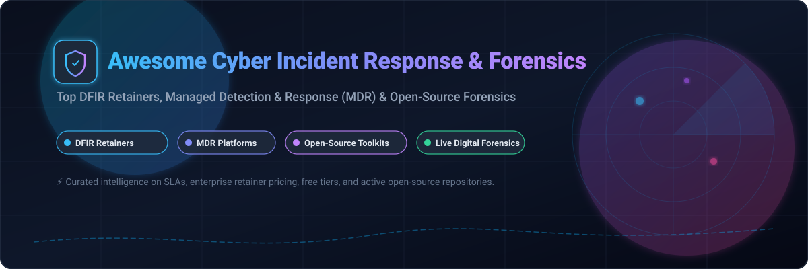

  

# 🛡️ Awesome Cyber Incident Response & Forensics (DFIR)

  
  
  
  
  
  
  

## 📌 Top Cyber Incident Response & Forensics Ecosystem

> **A curated collection of industry-leading SaaS Incident Response (IR) retainers, Managed Detection & Response (MDR) platforms, and premier open-source Digital Forensics and Incident Response (DFIR) frameworks.**

This comprehensive directory tracks battle-tested **SaaS platforms**, enterprise incident response retainers, and **open-source tools** designed for **Cyber Incident Response & Forensics**. Modern SOC teams, CIRTs (Cyber Incident Response Teams), and security leaders utilize these resources to proactively prepare for breaches, contain active intrusions with SLA guarantees, and perform deep forensic analysis across endpoints, networks, memory dumps, and cloud infrastructure.

---

## 📑 Table of Contents

- [🌐 Sector Overview & Market Dynamics](#-sector-overview--market-dynamics)
- [🏢 SaaS & Commercial Retainer Platforms](#-saas--commercial-retainer-platforms)
- [💻 Open-Source GitHub Projects](#-open-source-github-projects)
- [🛠️ IR Retainer vs. Open-Source Strategy](#%EF%B8%8F-ir-retainer-vs-open-source-strategy)
- [🤝 How to Contribute](#-how-to-contribute)
- [⭐ Star History](#-star-history)
- [💖 Support & Sponsorship](#-support--sponsorship)
- [⚖️ Disclaimer](#%EF%B8%8F-disclaimer)

---

## 🌐 Sector Overview & Market Dynamics

The global Incident Response (IR) and Digital Forensics market is estimated at **$40.4B – $49.7B in 2026** and projected to surge past **$100B+ by 2030** at a compound annual growth rate (CAGR) of **~21%**, propelled by escalating ransomware threats, cloud-native migration, and strict breach disclosure mandates.

Market dynamics reflect a **moderately fragmented landscape** rather than a winner-take-all monopoly: while mega-cap platform providers (Palo Alto Networks, CrowdStrike, Google Mandiant) dominate enterprise EDR/XDR ecosystems and frontline IR retainers, the space is balanced by specialized boutique forensic consultancies, dedicated mid-market MDR vendors (Arctic Wolf, Sophos), and an indispensable open-source foundation that powers daily practitioner triage.

---

## 🏢 SaaS & Commercial Retainer Platforms

Enterprise incident response solutions, pre-negotiated DFIR retainers, and managed detection services sorted in descending order by parent company scale (market capitalization or enterprise valuation).

| Product | Company Size / Valuation | Description | Pricing (Starting) | Free Tier / Trial Limits |
|:---|:---|:---|:---|:---|
| **[Mandiant Incident Response](https://www.mandiant.com/)** | **~$2.1T+** *(Alphabet / Google Cloud)* | Frontline DFIR retainer offering platform-agnostic breach investigation and proactive cyber readiness services. | **No-cost retainer** (Time & Materials billing upon incident declaration) or prepaid consulting hours from **$350 – $500/hour** | **No-cost retainer** tier available (no upfront retainer fee until incident engagement begins); **Mandiant Advantage** provides a permanent free threat intelligence tier (limited IOCs and threat actor summaries) |
| **[Palo Alto Unit 42](https://unit42.paloaltonetworks.com/)** | **~$265B** *(PANW Market Cap)* | Elite DFIR unit delivering incident response, digital forensics, compromise assessments, and crisis containment. | Retainer credits starting at **$5,000 – $10,000/year** (prepaid draw-down model) or custom multi-tier credit bundles | **250 free incident response hours** with a 2-hour SLA for qualified AWS Security Incident Response enterprise customers; AWS SecOps includes a free tier of **first 10,000 findings/month** |
| **[CrowdStrike Falcon Complete](https://www.crowdstrike.com/)** | **~$235B** *(CRWD Market Cap)* | 24/7 managed detection and response (MDR) alongside emergency DFIR response backed by Falcon EDR. | **~$125.00 per endpoint/year** (~$10.42/endpoint/month) for Falcon Complete MDR packages | **15-day free trial** of the Falcon platform (covers Falcon Prevent NGAV and core endpoint telemetry; no credit card required) |
| **[SentinelOne Vigilance](https://www.sentinelone.com/)** | **~$8.0B** *(S Market Cap)* | Autonomous 24/7 MDR service providing SOC triage, threat containment, and forensic analysis across Singularity XDR. | **~$27.99 per endpoint/year** (~$2.33/endpoint/month add-on to core EDR licenses) | **30-day Proof-of-Concept (PoC) trial** arranged via sales/authorized partner engineering (full feature access for up to 50–100 test endpoints) |
| **[Arctic Wolf](https://arcticwolf.com/)** | **~$4.3B** *(Private Valuation; ~$430M ARR)* | Security operations and turnkey incident response retainers with dedicated concierge teams. | **$6,000/year** for JumpStart Retainer (includes emergency SLA response planning and a discounted **$325/hour** emergency IR rate) | No free tier; offers a structured **30-day guided Security Operations / MDR PoC** through partner networks |
| **[Sophos Rapid Response](https://www.sophos.com/)** | **~$3.9B** *(Thoma Bravo Buyout; ~$1.2B Revenue)* | Rapid incident containment service offering 24/7 triage and remediation for active breaches within hours. | Fixed engagement starting from **$15,000 – $25,000 per 45-day incident block** (scaled by server and user asset counts) | **30-day free trial** for Sophos Central / Intercept X Advanced endpoint protection with EDR features (unlimited local testing on trial devices) |
| **[Kroll Cyber Risk](https://www.kroll.com/)** | **~$1.5B+** *(Annual Revenue; Stone Point Capital)* | Full-lifecycle incident management, forensic investigations, breach notification, and expert witness testimony. | Enterprise retainers starting from **$10,000/year** in prepaid blocks or customized advisory scopes | No permanent free tier; offers custom **advisory scoping sessions** and threat surface review demos upon request |
| **[Rapid7 Incident Command](https://www.rapid7.com/)** | **~$1.0B** *(RPD Market Cap)* | Unified incident command and DFIR retainer packages integrated with InsightIDR SIEM/XDR. | **$70.40 per asset/year** (~$5.87/asset/month) for InsightIDR (minimum 251 assets; ~$17,670/year base) | **30-day free trial** of InsightIDR / Incident Command platform with full log ingestion and user behavior analytics (UBA) capabilities |
| **[Secureworks Taegis](https://www.secureworks.com/)** | **~$859M** *(Sophos Acquisition; ~$366M Revenue)* | Taegis ManagedXDR platform combined with rapid DFIR investigation and vulnerability response. | **$37.88 per asset/year** (~$3.16/asset/month for Taegis VDR/EDR tier, 1001–2500 volume band) | **30-day interactive Taegis platform trial** and guided SOC test sandbox through authorized sales engineers |
| **[Cybereason](https://www.cybereason.com/)** | **~$300M – $850M** *(Private / SoftBank / LevelBlue)* | Resilience Retainer providing incident investigation, forensic hunting, and proactive consulting credits. | Resilience Retainer credit commitments starting at **$10,000/year** (flexible drawdown across IR and consulting services) | **14-day cloud trial** of Cybereason Defense Platform with automated malicious operation (MalOp) correlation |

---

## 💻 Open-Source GitHub Projects

Curated open-source frameworks, forensics toolkits, and SIEM engines. Sorted in **descending order by GitHub Stars_Count**.

| Project | Stars_Badge | Description |
|:---|:---|:---|
| **[osquery](https://github.com/osquery/osquery)** |  | SQL-powered operating system instrumentation, monitoring, and analytics. Exposes an OS as a high-performance relational database, enabling fast incident response queries across endpoints. |
| **[Wazuh](https://github.com/wazuh/wazuh)** |  | Free, open-source SIEM and XDR platform providing unified endpoint protection, security log analysis, vulnerability detection, and automated incident response workflows. |
| **[Sigma](https://github.com/SigmaHQ/sigma)** |  | Generic and open signature format for SIEM systems, allowing threat hunters and DFIR practitioners to write detection rules once and deploy across diverse log environments. |
| **[YARA](https://github.com/VirusTotal/yara)** |  | The de facto pattern matching Swiss Army knife for malware researchers and incident responders to identify, classify, and triage malicious files and memory artifacts. |
| **[Volatility](https://github.com/volatilityfoundation/volatility)** |  | The classic open-source memory forensics framework for extracting artifacts from volatile RAM dumps (processes, network sockets, rootkits, and injected shellcode). |
| **[MISP](https://github.com/MISP/MISP)** |  | Open-source threat intelligence and sharing platform designed for collecting, storing, correlating, and sharing IOCs for collaborative incident response. |
| **[Cuckoo Sandbox](https://github.com/cuckoosandbox/cuckoo)** |  | Automated dynamic malware analysis system that analyzes suspicious files inside isolated virtual environments and generates comprehensive triage reports. |
| **[GRR Rapid Response](https://github.com/google/grr)** |  | Scalable incident response framework developed by Google focused on remote live forensics, fleet-wide memory and disk analysis, and evidence acquisition. |
| **[Volatility 3](https://github.com/volatilityfoundation/volatility3)** |  | The next-generation Python 3 memory analysis engine from the Volatility Foundation, offering modular plugins and cross-platform analysis (Windows, Linux, macOS). |
| **[Velociraptor](https://github.com/Velocidex/velociraptor)** |  | Advanced digital forensics and incident response platform. Agent-based collection using Velociraptor Query Language (VQL) for real-time endpoint triage and investigation at enterprise scale. |
| **[TheHive](https://github.com/TheHive-Project/TheHive)** |  | Scalable, open-source security incident response and case management platform tightly integrated with MISP and Cortex for tracking investigations and task workflows. |
| **[Chainsaw](https://github.com/WithSecureOpenSource/chainsaw)** |  | High-performance command-line tool designed for rapid first-response triage of Windows event logs using Sigma rules and custom hunting logic. |
| **[Timesketch](https://github.com/google/timesketch)** |  | Open-source tool for collaborative forensic timeline analysis. Uses Elasticsearch to visualize, search, and correlate forensic events across multiple sources and analysts. |
| **[Autopsy](https://github.com/sleuthkit/autopsy)** |  | Premier open-source digital forensics platform and graphical interface to The Sleuth Kit (TSK), widely deployed by law enforcement, military, and corporate investigators for hard drive forensics. |
| **[Plaso (log2timeline)](https://github.com/log2timeline/plaso)** |  | Python-based engine and toolkit designed for creating super timelines from evidence files, file systems, and forensic disk images. |
| **[FIR (Fast Incident Response)](https://github.com/certsocietegenerale/FIR)** |  | Cybersecurity incident management platform created by CERT Société Générale, designed for rapid creation, tracking, and metric reporting of security incidents. |
| **[SentinelSOC](https://github.com/heysayanallgood/SentinelSOC)** |  | Modular Blue Team and SOC toolkit for Linux and Termux. Combines threat intelligence, network analysis, live incident triage, persistence review, IOC sweeps, and multi-format DFIR reporting. |

---

## 🛠️ IR Retainer vs. Open-Source Strategy

Building an effective organizational defense requires a hybrid strategy:

1. **Endpoint Visibility & Collection**: Deploy **Velociraptor** or **osquery** across your fleet to ensure instant artifact acquisition and VQL hunting without license friction.
2. **Deep-Dive Forensic Triage**: Use **Volatility 3** for RAM extraction and **Chainsaw** / **Plaso** / **Timesketch** for rapid timeline reconstruction.
3. **Case Management & Correlation**: Standardize security investigations on **TheHive** integrated with **MISP** threat feeds.
4. **Commercial Retainers for Major Breaches**: Rely on commercial retainers (**Mandiant**, **Unit 42**, **CrowdStrike**) when legal privilege, board-level communications, regulatory reporting, and guaranteed 2-hour SLAs are mandatory.

---

## 🤝 How to Contribute

We welcome additions, corrections, and updates from the cybersecurity community!

1. 🍴 Fork the repository.
2. 🌿 Create a descriptive branch (`git checkout -b feature/add-new-dfir-tool`).
3. 📝 Update `README.md` following existing format and include:
   - Tool/Service name & official website or repo link.
   - Transparent pricing model, starting tiers, and explicit trial/free plan limits.
   - Accurate company scale or GitHub stargazer badge.
4. 🚀 Submit a Pull Request with a clear description of the addition.

---

## 📈 Star History

---

## 💖 Support & Sponsorship

If this curated ecosystem helps your SOC, CIRT, or cybersecurity research, please consider giving the repository a **⭐ Star**, **🍴 Forking** it, and sharing it with your network!

Your support keeps this guide updated with current pricing, SLA data, and community tooling:

  

☕ **Buy a coffee or become a sponsor**: Check out the [Sponsor Dashboard](https://github.com/sponsors/ishandutta2007) to back ongoing open-source maintenance.

---

## ⚖️ Disclaimer

- This is an independent, **community-curated directory** provided for educational and architectural reference only. It does not constitute formal legal or commercial endorsement.
- Incident response and forensic investigations frequently involve legally sensitive evidence, chain-of-custody protocols, and privileged communications. Consult qualified legal counsel when drafting IR retainers and forensic playbooks.
- Commercial IR retainer SLAs, starting prices, and promotional free tiers are subject to change by their respective vendors.

---

  <b>Built for SOC analysts, incident responders, forensic investigators, and organizations building cyber resilience.</b> 
  <i>Let's make incident response and digital forensics open, effective, and accessible.</i>

